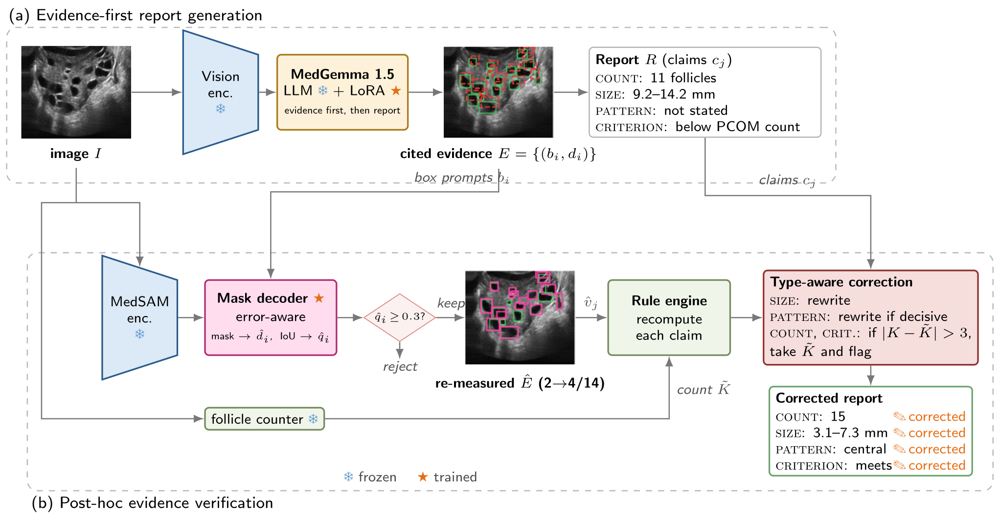

# [WACV'27 FABRIC Workshop] Trust but Verify: Evidence Verification for VLM-Generated PCOS Ultrasound Reports

<div>
  <strong>Toyiomfon Obot Udoete &amp; Shivanand Venkanna Sheshappanavar</strong><br>
  University of Wyoming
</div>

---

## Overview

Medical vision-language models write fluent reports, but fluency is not evidence. We ask a fine-tuned MedGemma 1.5 to cite every follicle as a box and a diameter before it writes its PCOS ultrasound report. Its reports score well on text metrics (BERTScore 0.98), yet the cited boxes rarely outline a follicle (evidence F1 0.07).

**Trust but Verify (TBV)** checks the report after it is written and never changes the VLM:

- **Re-measurement.** Each cited box prompts MedSAM. Its error-aware mask decoder is trained on human annotations and on MedGemma's own mistakes. A citation is rejected when the decoder's predicted IoU is below 0.30.
- **Claim recomputation.** A rule engine recomputes SIZE and PATTERN from the follicles that were kept.
- **Count check.** COUNT and the PCOM criterion are compared with an independent YOLO11 counter. A report whose count differs by more than three is flagged and takes its count from the counter.

<!-- Add the method figure here, e.g.  -->

## Results

All components are trained on Figshare and tested on 100 Kaggle images against a blind ground truth.

| Method | P | R | F1 | Diameter MAE (mm) | SIZE within 0.5 mm |
|---|---|---|---|---|---|
| MedGemma 1.5 (unverified) | 0.08 | 0.06 | 0.07 | 5.13 | 0% |
| Qwen2.5-VL 32B (refine) | 0.08 | 0.06 | 0.07 | 1.08 | 2% |
| SAM2 | 0.18 | 0.13 | 0.15 | 1.16 | 12% |
| **TBV (ours)** | **0.67** | **0.28** | **0.40** | **0.68** | **15%** |

## Installation

```bash
git clone https://github.com/ToyioUdoete/trust-but-verify.git
cd trust-but-verify
conda create -n tbv python=3.12 -y && conda activate tbv
pip install -r requirements.txt
```

MedGemma, PaliGemma 2 and Qwen2.5-VL are gated on Hugging Face. Accept their terms and log in with `huggingface-cli login` before running.

## Data

See [DATASETS.md](DATASETS.md). Download the Kaggle images, then run:

```bash
python prepare/remap_paths.py --image_dir /path/to/kaggle_images
```

## Checkpoints

Download from the [release page](https://github.com/ToyioUdoete/trust-but-verify/releases) into `checkpoints/`.

| File | What it is |
|---|---|
| `medgemma_lora/` | MedGemma 1.5 (4B) LoRA adapter, evidence-first, trained on Figshare |
| `decoder_seed{0,1,2}.pt` | MedSAM mask decoder trained on Figshare annotations |
| `decoder_error_aware_seed{0,1,2}.pt` | error-aware MedSAM mask decoder (seed 0 is used for TBV) |
| `rejection_thresholds.json` | rejection threshold on the predicted IoU, chosen on Figshare |
| `counter_yolo11s.pt`, `counter.json` | YOLO11s follicle counter and its confidence threshold (0.40) |

## Reproducing the paper

Run every script from the repository root. Each script has its settings at the top, and the long ones resume if they are interrupted.

```bash
# training (skip if you use the released checkpoints)
python train/decoder.py            # MedSAM decoder on Figshare, 3 seeds
python train/counter.py            # YOLO11 counter on Figshare
python train/generator.py          # MedGemma on Figshare -> Kaggle; re-measurement; counter boxes
python train/error_aware.py        # error-aware decoder + rejection threshold

# verification and baselines
python verify.py
python baselines/qwen_sam2.py
python baselines/second_vlms.py

# tables and figures
python evaluate/text_metrics.py          # Table 1
python evaluate/main_tables.py           # Table 2 and Table 4
python evaluate/second_vlm_verifiers.py  # Table 2, PaliGemma 2 and LLaVA-Med rows
python evaluate/example_case.py          # Table 3
python evaluate/count_correction.py      # Table 4, count correction row
python evaluate/robustness.py            # Table 5
python evaluate/sensitivity.py           # threshold sensitivity, recall by follicle size
python evaluate/rejection_rates.py
python figures/make_figures.py
python figures/example_image.py
```

`train/generator.py` writes `outputs/test_cache.pkl` and `verify.py` writes `outputs/tbv_cache.pkl`; the scripts after them read these files. Confidence intervals use 1,000 bootstrap resamples of near-duplicate groups.

## Citation

```bibtex
@inproceedings{udoete2027trust,
  title     = {Trust but Verify: Evidence Verification for VLM-Generated PCOS Ultrasound Reports},
  author    = {Udoete, Toyiomfon Obot and Sheshappanavar, Shivanand Venkanna},
  booktitle = {Proceedings of the IEEE/CVF Winter Conference on Applications of Computer Vision (WACV) Workshops},
  year      = {2027}
}
```

## License

The code is released under the [MIT License](LICENSE). The models it builds on keep their own terms: MedGemma ([Health AI Developer Foundations terms](https://developers.google.com/health-ai-developer-foundations/terms)), MedSAM (Apache-2.0), Ultralytics YOLO11 (AGPL-3.0), PaliGemma 2 (Gemma terms), LLaVA-Med and Qwen2.5-VL (their respective licenses). The datasets keep the licenses of their sources.

## Acknowledgements

We build on [MedGemma](https://huggingface.co/google/medgemma-1.5-4b-it), [MedSAM](https://github.com/bowang-lab/MedSAM), [SAM2](https://github.com/facebookresearch/sam2), [Ultralytics](https://github.com/ultralytics/ultralytics), and the Figshare and Kaggle PCOS datasets.
