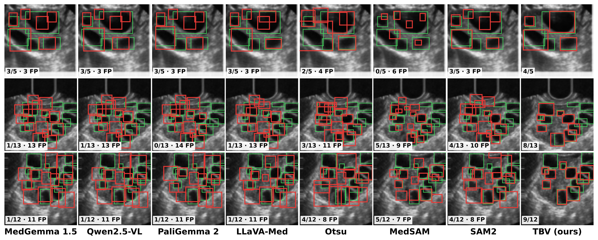

# [WACV'27 FABRIC Workshop] Trust but Verify: Evidence Verification for VLM-Generated PCOS Ultrasound Reports

<div>
  <strong>Toyiomfon Obot Udoete &amp; Shivanand Venkanna Sheshappanavar</strong><br>
  University of Wyoming
</div>

---

## Overview

Medical vision-language models write fluent reports, but fluency is not evidence. We ask a fine-tuned MedGemma 1.5 to cite every follicle as a box and a diameter before it writes its PCOS ultrasound report. Its reports score well on text metrics (BERTScore 0.98), yet the cited boxes rarely outline a follicle (evidence F1 0.07).

**Trust but Verify (TBV)** checks the report after it is written and never changes the VLM:

- **Re-measurement.** Each cited box prompts MedSAM. Its error-aware mask decoder is trained on human annotations and on MedGemma's own mistakes. A citation is rejected when the decoder's predicted IoU is below 0.30.
- **Claim recomputation.** A rule engine recomputes SIZE and PATTERN from the follicles that were kept.
- **Count check.** COUNT and the PCOM criterion are compared with an independent YOLO11 counter. A report whose count differs by more than three is flagged and takes its count from the counter.

## Architecture

[](assets/overview.png)

(a) MedGemma cites each follicle as a box and a diameter, then writes the report. (b) TBV re-measures each cited box with an error-aware MedSAM decoder, rejects citations with predicted IoU below 0.30, recomputes the claims from the kept follicles and checks the count against an independent counter.

## Results

All components are trained on Figshare and tested on 100 Kaggle images against a blind ground truth.

| Method | P | R | F1 | Diameter MAE (mm) | SIZE within 0.5 mm |
|---|---|---|---|---|---|
| MedGemma 1.5 (unverified) | 0.08 | 0.06 | 0.07 | 5.13 | 0% |
| Qwen2.5-VL 32B (refine) | 0.08 | 0.06 | 0.07 | 1.08 | 2% |
| SAM2 | 0.18 | 0.13 | 0.15 | 1.16 | 12% |
| **TBV (ours)** | **0.67** | **0.28** | **0.40** | **0.68** | **15%** |

## Examples

[](assets/examples.png)

Cited evidence on three test images. Red: boxes each method keeps or produces; green: ground truth. x/y: boxes that match a ground-truth follicle (IoU ≥ 0.5), out of all ground-truth follicles; FP: boxes that match none.

## Installation

```bash
git clone https://github.com/ToyioUdoete/trust-but-verify.git
cd trust-but-verify
conda create -n tbv python=3.12.2 -y && conda activate tbv
pip install -r requirements.txt
```

MedGemma, PaliGemma 2 and Qwen2.5-VL are gated on Hugging Face. Accept their terms and log in with `hf auth login` before running.

## Data

See [DATASETS.md](DATASETS.md). Figshare annotations are on the [release page](https://github.com/ToyioUdoete/trust-but-verify/releases); unzip them into `data/figshare/` and put the Kaggle images in `data/kaggle/`.

## Checkpoints

Download from the [release page](https://github.com/ToyioUdoete/trust-but-verify/releases) into `checkpoints/`.

| File | What it is |
|---|---|
| `medgemma_lora/` | MedGemma 1.5 (4B) LoRA adapter, evidence-first, trained on Figshare |
| `decoder_seed{0,1,2}.pt` | MedSAM mask decoder trained on Figshare annotations |
| `decoder_error_aware_seed{0,1,2}.pt` | error-aware MedSAM mask decoder (seed 0 is used for TBV) |
| `rejection_thresholds.json` | rejection threshold on the predicted IoU, chosen on Figshare |
| `counter_yolo11s.pt`, `counter.json` | YOLO11s follicle counter and its confidence threshold (0.40) |

## Repository structure

```
scripts/
  train/
    decoder.py               MedSAM mask decoder on Figshare (3 seeds)
    counter.py               YOLO11s follicle counter on Figshare
    generator.py             MedGemma on Figshare, citations and re-measurement on the Kaggle test set
    error_aware.py           error-aware decoder and rejection threshold
  verify/
    tbv.py                   TBV: re-measure, reject, recompute claims (Table 4)
  baselines/
    qwen_sam2.py             Qwen2.5-VL 32B (check, refine, judge) and SAM2 (Table 2)
    second_vlms.py           PaliGemma 2 and LLaVA-Med (Table 2)
  evaluate/
    text_metrics.py          Table 1
    main_tables.py           Tables 2 and 4
    second_vlm_verifiers.py  Table 2, PaliGemma 2 and LLaVA-Med rows
    example_case.py          Table 3
    count_correction.py      Table 4, count correction row
    robustness.py            Table 5
    sensitivity.py           threshold sensitivity, recall by follicle size
    rejection_rates.py       rejected citations and fallbacks
```

Run the scripts from the repository root in the order above.

## License

The code is released under the [MIT License](LICENSE). The models it builds on keep their own terms: MedGemma ([Health AI Developer Foundations terms](https://developers.google.com/health-ai-developer-foundations/terms)), MedSAM (Apache-2.0), Ultralytics YOLO11 (AGPL-3.0), PaliGemma 2 (Gemma terms), LLaVA-Med and Qwen2.5-VL (their respective licenses). The datasets keep the licenses of their sources.

## Acknowledgements

We build on [MedGemma](https://huggingface.co/google/medgemma-1.5-4b-it), [MedSAM](https://github.com/bowang-lab/MedSAM), [SAM2](https://github.com/facebookresearch/sam2), [Ultralytics](https://github.com/ultralytics/ultralytics), and the Figshare and Kaggle PCOS datasets.
